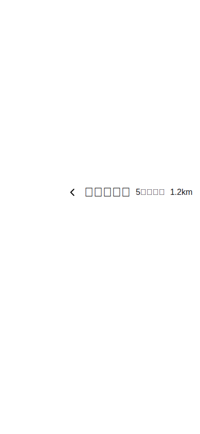
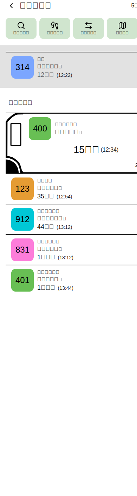
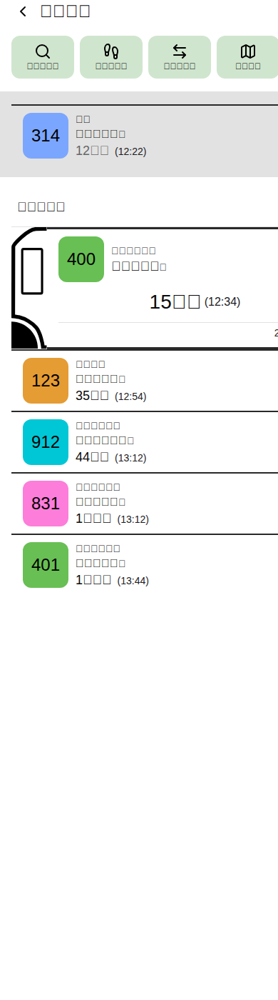

# Screenshots: Conditional Distance Display Feature

This document shows the conditional distance display feature on the bus stop page.

## Feature Summary

The distance indicator is now only shown when:
- User's location permission is granted
- User is >= 10 meters away from the bus stop (configurable via `NEXT_PUBLIC_MINIMUM_DIST_INDICATOR`)

When the user is very close to the bus stop (<10m by default) or location permission is denied, the distance is hidden.

## Screenshots

### Bus Stop Header Component

#### With Distance (User is far from stop)


Shows "秋田駅東口 5番のりば" with distance "1.2km" displayed on the right side.

#### Without Distance (User is close to stop)


Shows "市役所前 2番のりば" without any distance indicator (user is within the minimum threshold).

### Full Bus Stop Info Page

#### With Distance (User is far from stop)


Full page view showing the distance "5駅先" in the header when user is far from the bus stop.

#### Without Distance (User is close to stop)


Full page view showing "市役所前" without distance when user is close to the bus stop.

## Environment Configuration

Add to `.env` or `.env.local`:

```bash
# Minimum distance in meters to display distance indicator on bus stop page
# Distance will only be shown if user is >= this value away from the bus stop
NEXT_PUBLIC_MINIMUM_DIST_INDICATOR=10
```

## Implementation Details

- Haversine formula is used to calculate distance between user's location and bus stop
- Shared `useGeolocation` hook provides consistent location handling
- Distance calculation happens in `BusStopInfoV2Container` using the new `calculateDistance()` function
- The threshold check ensures distance is only shown when meaningful to the user
